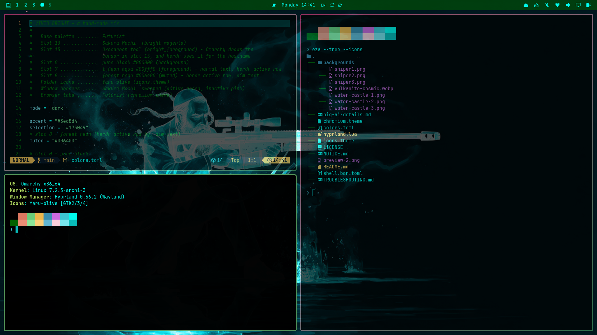
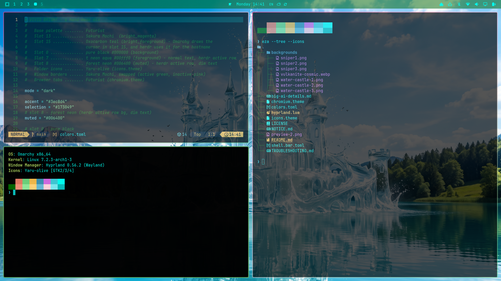

Bresleveloper AI having fun with Omarchy!

# Vivid Bright





## Install

```sh
omarchy theme install https://github.com/bresleveloper-ai-agents/omarchy-bresleveloper-vivid-bright-theme
```

It installs as **Bresleveloper Vivid Bright** and is applied right away.

To remove it later, switch to another theme first, then:

```sh
omarchy theme remove bresleveloper-vivid-bright
```

A neon mix on pure black: aqua text, forest-green highlights, a teal cursor,
Sakura Mochi's pink/green window borders, a half-transparent green bar and
see-through windows with softly rounded corners.

Built from pieces of Futurist, Sakura Mochi and Oxocarbon. Full details,
sources and commands: [big-ai-details.md](big-ai-details.md).

## Window look (manual step)

The rounded corners and see-through windows live in
[`hyprland.lua`](hyprland.lua) (border colours work either way). Omarchy never loads Lua from a theme
installed from GitHub, so it's included here for you to enable by hand.

After installing, read `hyprland.lua`, then turn the theme into a local one
(Omarchy only restricts themes that still have a `.git` folder):

```sh
rm -rf ~/.config/omarchy/themes/bresleveloper-vivid-bright/.git
omarchy theme set bresleveloper-vivid-bright
```

This also means `omarchy theme update` won't update it any more — reinstall
to get a newer version.

## Thanks

Vivid Bright is a mix of ideas borrowed from six Omarchy themes. Thanks to
their creators:

| Theme | Creator | What it gave this theme |
|-------|---------|-------------------------|
| [Futurist](https://github.com/benwillems/omarchy-futurist-theme) | [benwillems](https://github.com/benwillems) | The base palette and the turquoise browser tabs |
| [Sakura Mochi](https://github.com/OldJobobo/omarchy-sakura-mochi-theme) | [OldJobobo](https://github.com/OldJobobo) | The pink/green window borders (swapped here), slot 13, and the window-look ideas |
| [Oxocarbon](https://github.com/HANCORE-linux/omarchy-oxocarbon-theme) | [HANCORE-linux](https://github.com/HANCORE-linux) | The teal cursor and hostname colour |
| [Blackturq](https://github.com/HANCORE-linux/omarchy-blackturq-theme) | [HANCORE-linux](https://github.com/HANCORE-linux) | Its `BG5.jpg` neon girl-sniper artwork — the base for the `sniper*` wallpapers here. Great thanks for the art! |
| [Castle On A Lake](https://github.com/shmall03/omarchy-castle-on-a-lake-theme) | [shmall03](https://github.com/shmall03) | Inspiration: its two castle paintings, by artist **Raphael Lacoste**, were used locally while building this theme. They are **not included** here because they're his artwork. Get them from Castle On A Lake. |
| [Vulkanite](https://github.com/kyerpotts/omarchy-vulkanite-theme) | [kyerpotts](https://github.com/kyerpotts) | The cosmic wallpaper |

Licensing details for every borrowed piece are in [NOTICE.md](NOTICE.md).

And thanks to [Omarchy](https://omarchy.org/) itself for making all of this
a few text files.
